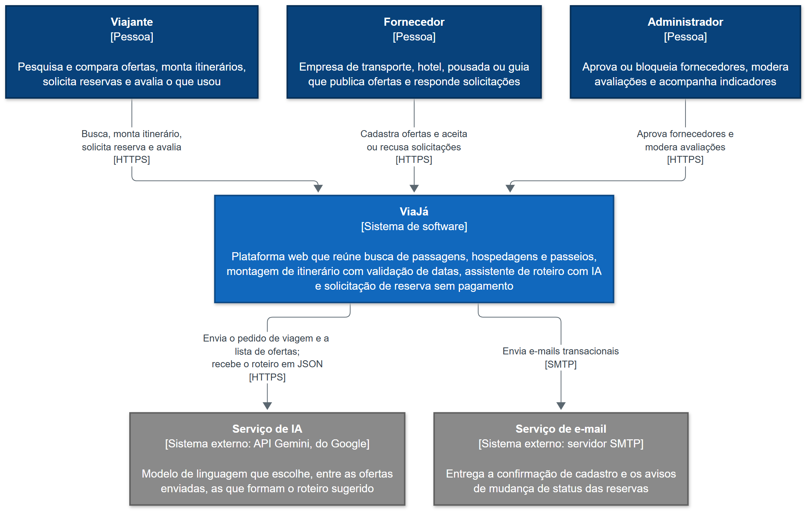
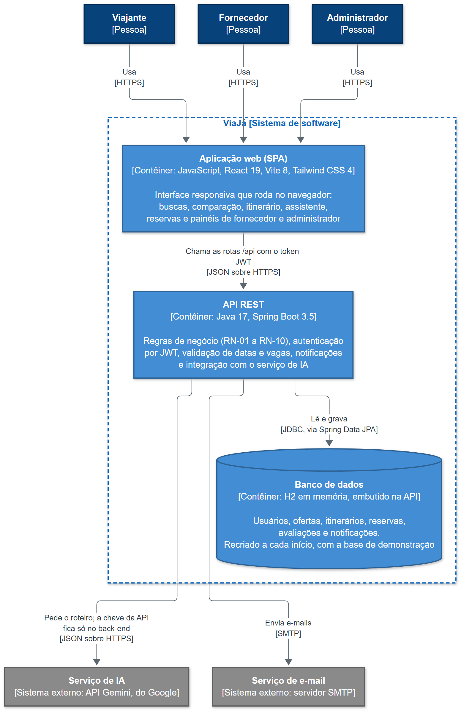
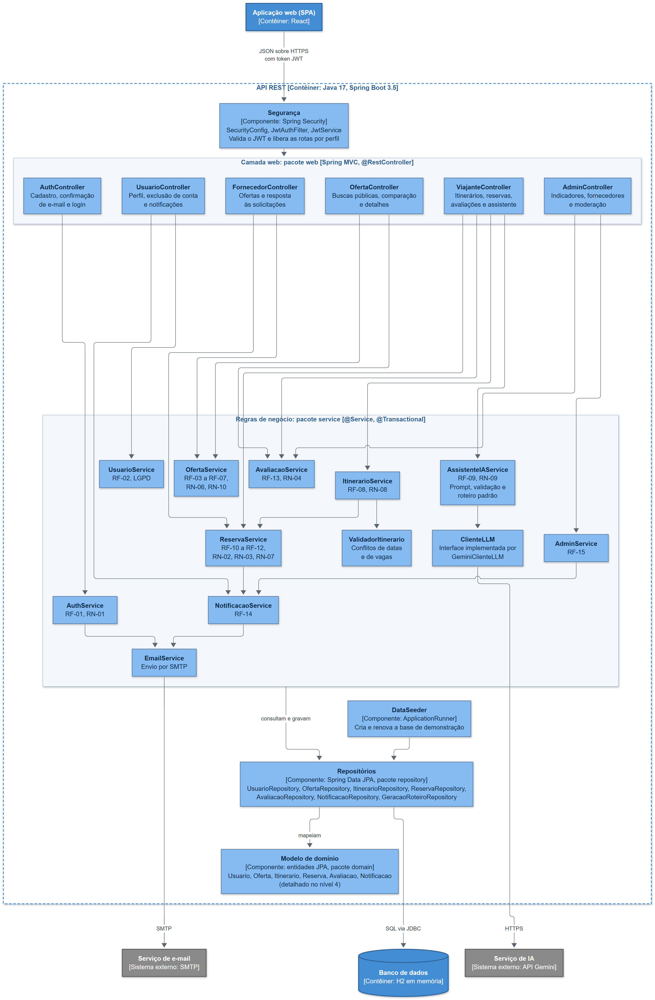
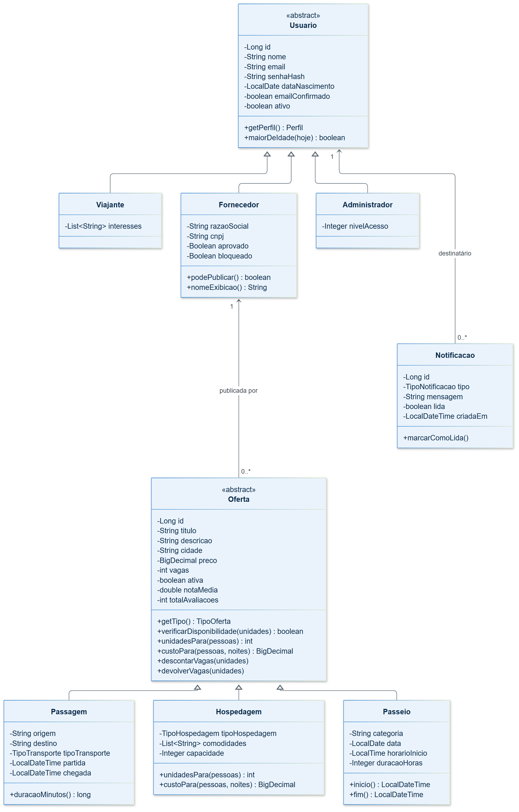
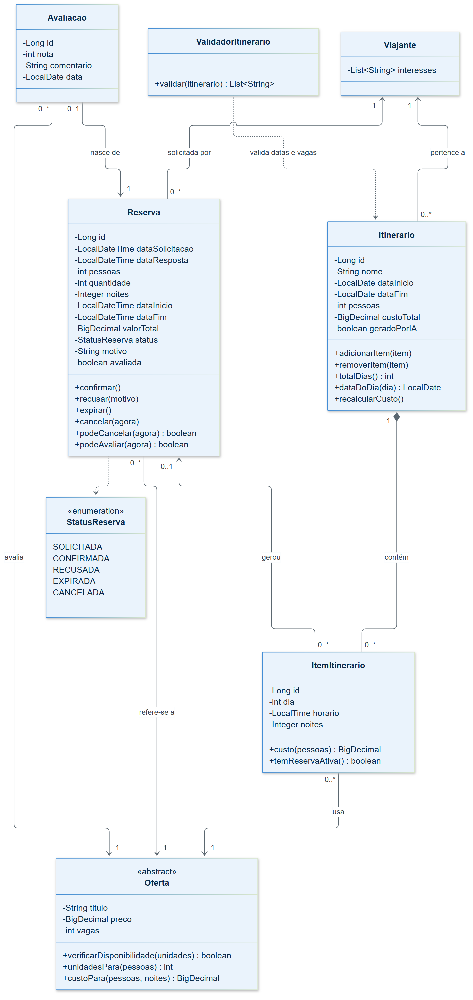
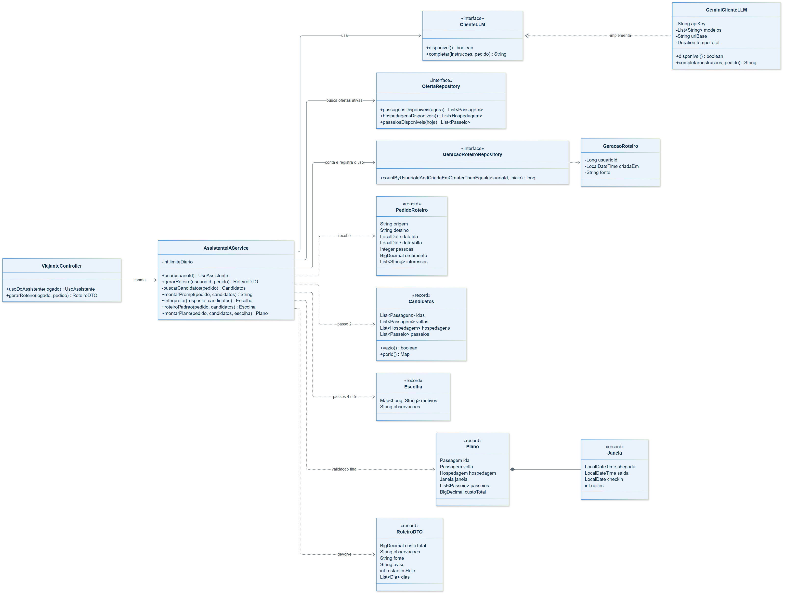

# Modelo C4 do ViaJá

O modelo C4 descreve a arquitetura em quatro níveis de zoom: **Contexto**, **Contêineres**, **Componentes** e **Código**. Cada nível responde a uma pergunta diferente, do "quem usa o sistema" até "como as classes se relacionam".

A versão para o Overleaf está em [`modelo-c4.tex`](modelo-c4.tex) (envie a pasta `docs/c4` inteira, com `img/`).

| Cor | Elemento |
|---|---|
| Azul-escuro | Pessoa (ator) |
| Azul | Sistema ViaJá |
| Azul-médio | Contêiner (algo que roda ou guarda dados) |
| Azul-claro | Componente (parte de um contêiner) |
| Cinza | Sistema externo |

## Nível 1: Contexto

Quem usa o ViaJá e com quais sistemas externos ele conversa.



| Elemento | Tipo | Papel |
|---|---|---|
| Viajante | Pessoa | Pesquisa e compara ofertas, monta itinerários, usa o assistente de IA, solicita reservas e avalia |
| Fornecedor | Pessoa | Empresa de transporte, hotel, pousada ou guia. Publica ofertas e aceita ou recusa solicitações |
| Administrador | Pessoa | Aprova ou bloqueia fornecedores, modera avaliações e acompanha indicadores |
| ViaJá | Sistema | Plataforma web de busca, itinerário e solicitação de reserva sem pagamento |
| Serviço de IA | Sistema externo | API Gemini, do Google. Recebe o pedido de viagem e a lista de ofertas e devolve o roteiro em JSON |
| Serviço de e-mail | Sistema externo | Servidor SMTP que entrega a confirmação de cadastro e os avisos de reserva |

Fora do contexto de propósito (seção 1.3 do planejamento): gateway de pagamento, emissão de bilhetes e APIs de companhias aéreas ou redes hoteleiras.

## Nível 2: Contêineres

As partes que rodam separadas e como se comunicam.



| Contêiner | Tecnologia | Responsabilidade |
|---|---|---|
| Aplicação web (SPA) | JavaScript, React 19, Vite 8, Tailwind CSS 4 | Interface responsiva no navegador. Não guarda regra de negócio nem segredo |
| API REST | Java 17, Spring Boot 3.5, Spring Security, Spring Data JPA | Regras de negócio, autenticação por JWT, validação de datas e vagas, notificações e chamada ao serviço de IA |
| Banco de dados | H2 em memória, embutido na API | Usuários, ofertas, itinerários, reservas, avaliações e notificações |

Decisões que aparecem neste nível:

- **A SPA só fala com a API.** O navegador nunca acessa o banco nem o serviço de IA. Por isso a chave da API de IA fica só no back-end (RNF-05).
- **Sessão sem estado.** Depois do login a SPA envia o token JWT (válido por 24 h) no cabeçalho `Authorization` de cada chamada (RNF-03).
- **Banco em memória.** O H2 roda dentro do processo da API, sem instalação. Os dados existem enquanto a API está no ar e a base de demonstração é recriada a cada início, o que deixa a apresentação sempre no mesmo ponto de partida. Ele aparece como contêiner separado porque é onde os dados ficam, e o acesso passa só pelos repositórios JPA: trocar por um banco em servidor muda a configuração, não o código.
- **IA com modelo reserva.** A API chama o Gemini por HTTPS com limite total de 15 segundos (RNF-02). Se o primeiro modelo estiver sobrecarregado, tenta o seguinte; se nenhum responder, devolve o roteiro padrão.

## Nível 3: Componentes

O que existe dentro do contêiner **API REST**. Cada componente é um conjunto de classes do projeto em [`backend/src/main/java/br/ucsal/viaja`](../../backend/src/main/java/br/ucsal/viaja).



| Componente | Classes | Responsabilidade | Requisitos |
|---|---|---|---|
| Segurança | `SecurityConfig`, `JwtAuthFilter`, `JwtService` | Valida o JWT, identifica o perfil e libera as rotas por perfil; senhas com bcrypt | RNF-03 |
| Camada web | `AuthController`, `UsuarioController`, `OfertaController`, `ViajanteController`, `FornecedorController`, `AdminController`, `ApiExceptionHandler` | Recebe as requisições HTTP, valida o formato dos dados e devolve JSON. Erros saem sempre como `{ "erro": ... }` | Todos os RF |
| `AuthService` | | Cadastro com confirmação de e-mail e login | RF-01, RN-01 |
| `UsuarioService` | | Edição de perfil e exclusão da conta com remoção dos dados pessoais | RF-02, RNF-04 |
| `OfertaService` | | Buscas com filtros, comparação e cadastro de ofertas | RF-03 a RF-07, RN-05, RN-06, RN-10 |
| `ItinerarioService` e `ValidadorItinerario` | | Itinerário por dia, custo total e conflitos de datas e de vagas | RF-08, RN-08 |
| `ReservaService` | | Solicitação, aceite, recusa, cancelamento, expiração em 48 h e lembrete | RF-10 a RF-12, RN-02, RN-03, RN-07 |
| `AvaliacaoService` | | Avaliação de itens usufruídos e nota média | RF-13, RN-04 |
| `NotificacaoService` e `EmailService` | | Aviso dentro do sistema e por e-mail a cada mudança de status | RF-14 |
| `AdminService` | | Indicadores e aprovação ou bloqueio de fornecedores | RF-15 |
| `AssistenteIAService` | | Monta o prompt, chama o modelo, valida a resposta e aplica o roteiro padrão se a IA falhar | RF-09, RN-09, RNF-02 |
| `ClienteLLM` | `GeminiClienteLLM` | Interface de saída para o serviço de IA. A implementação chama a API Gemini por HTTPS, com limite de 15 s e modelo reserva | RNF-02, RNF-05 |
| Repositórios | `UsuarioRepository`, `OfertaRepository`, `ItinerarioRepository`, `ReservaRepository`, `AvaliacaoRepository`, `NotificacaoRepository`, `GeracaoRoteiroRepository` | Consultas e gravação com Spring Data JPA | |
| Modelo de domínio | Pacote `domain` | Entidades e regras que pertencem aos próprios objetos (detalhado no nível 4) | RN-01 a RN-04 |
| `DataSeeder` | | Cria a base de demonstração e renova as ofertas datadas a cada início | Seção 1.9 |

O fluxo de uma requisição é sempre o mesmo: **Segurança → Controller → Service → Repository → Banco**. Os controllers não têm regra de negócio e os services não conhecem HTTP.

## Nível 4: Código

Três diagramas de classes, um para cada parte mais importante do código.

### 4.1 Usuários e ofertas

`Usuario` e `Oferta` são classes abstratas. Cada hierarquia é gravada em uma única tabela (`usuarios` e `ofertas`), com uma coluna que diz o tipo da linha. `Hospedagem` sobrescreve `unidadesPara` e `custoPara` porque cobra por quarto e por noite; passagem e passeio cobram por pessoa.



### 4.2 Itinerário, reserva e avaliação

`Itinerario` é composto por `ItemItinerario`: apagar o itinerário apaga os itens. A `Reserva` guarda o status e concentra as transições do BPMN (`confirmar`, `recusar`, `expirar`, `cancelar`), junto com as regras de prazo. O `ValidadorItinerario` devolve a lista de conflitos que bloqueia o envio das solicitações.



### 4.3 Assistente de roteiro com IA

O `AssistenteIAService` depende da interface `ClienteLLM`, e não do provedor de IA. Isso permite trocar o provedor do modelo e testar o assistente sem chamar a API. Os registros `Candidatos`, `Escolha`, `Janela` e `Plano` são os passos da seção 10.2 do planejamento: buscar ofertas, receber a escolha da IA, validar e montar.



## Como gerar as imagens de novo

Os diagramas são escritos em [Mermaid](https://mermaid.js.org) nos arquivos `.mmd` desta pasta. Para gerar os PNG depois de uma alteração:

```bash
npx -y @mermaid-js/mermaid-cli -c mermaid-config.json -C mermaid.css -b white -s 2 -i c4-1-contexto.mmd -o img/c4-1-contexto.png
```

Repita trocando o nome do arquivo. Nos três diagramas de classes (`c4-4-*`), troque `-s 2` por `--size 3000`.
