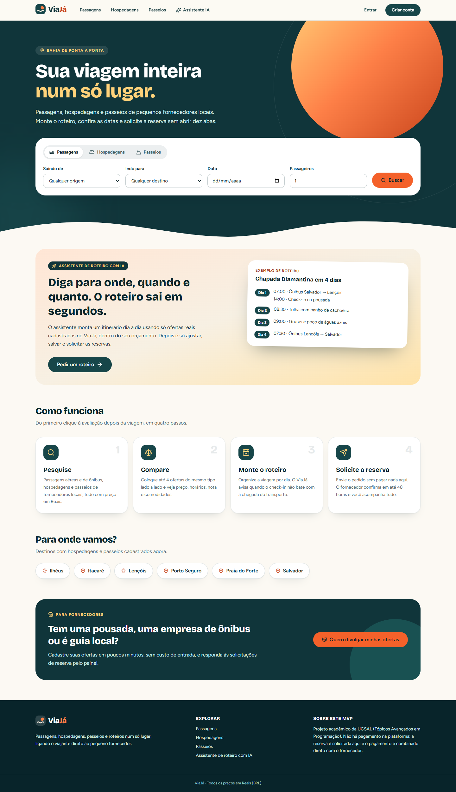
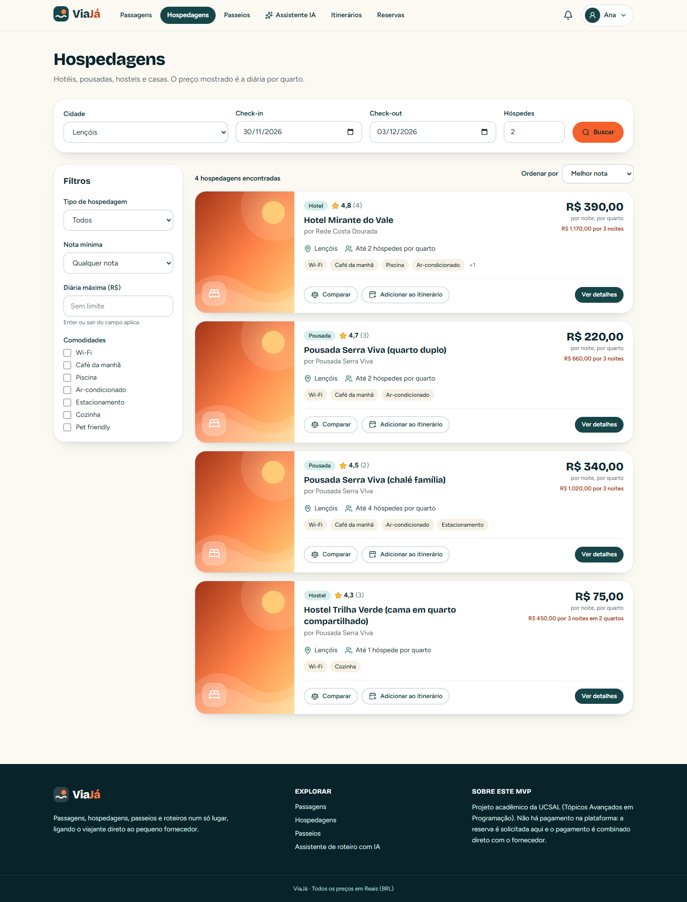
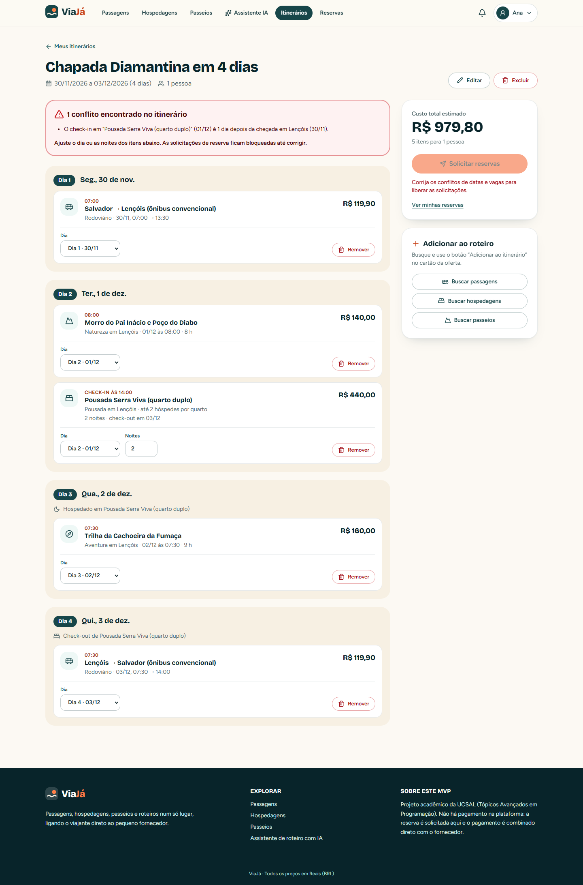
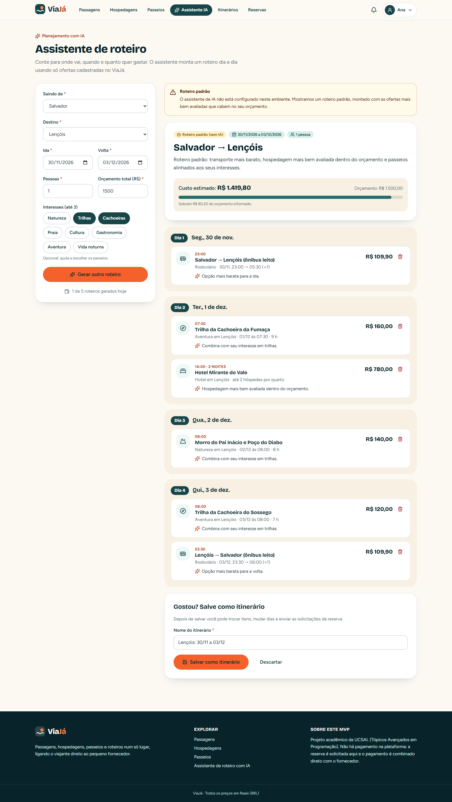
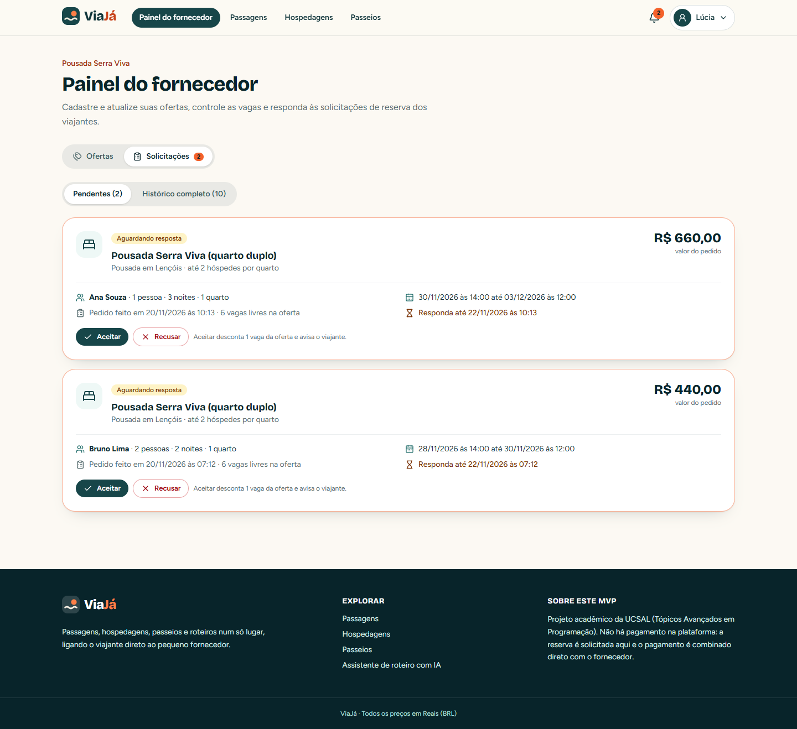
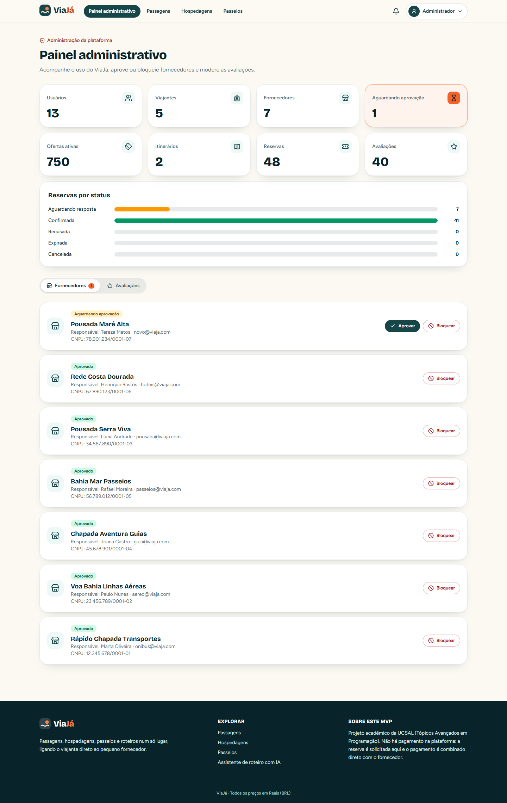

# Telas do front-end

Capturas da aplicação rodando com a base de demonstração, feitas em 1440 px de largura (as três últimas, em 390 px, tamanho de celular). Elas seguem a ordem de uso descrita na seção 1.5 do planejamento.

## Visitante

| Tela | O que mostra | Requisitos |
|---|---|---|
| [Início](01-inicio.png) | Busca em abas, chamada para o assistente e como funciona | RF-04 a RF-06 |
| [Cadastro](02-cadastro.png) | Escolha entre viajante e fornecedor | RF-01, RN-01 |
| [Confirmação de e-mail](03-cadastro-confirmacao.png) | Aviso depois do cadastro, com o link do modo demonstração | RF-01 |
| [Entrar](04-entrar.png) | Login e atalhos das contas de demonstração | RF-01 |

## Busca e comparação

| Tela | O que mostra | Requisitos |
|---|---|---|
| [Busca de passagens](05-busca-passagens.png) | Origem, destino, data e filtros de preço, horário e tipo | RF-04 |
| [Busca de hospedagens](06-busca-hospedagens.png) | Cidade, período, hóspedes e filtros de nota e comodidades | RF-05 |
| [Busca de passeios](07-busca-passeios.png) | Cidade, data e filtro por categoria | RF-06 |
| [Comparação](08-comparar.png) | Até 4 ofertas do mesmo tipo lado a lado | RF-07, RN-10 |
| [Detalhe da oferta](09-oferta-detalhe.png) | Descrição, avaliações e solicitação de reserva | RF-10, RF-13 |

## Itinerário

| Tela | O que mostra | Requisitos |
|---|---|---|
| [Meus itinerários](10-itinerarios.png) | Lista de itinerários do viajante | RF-08 |
| [Itinerário por dia](11-itinerario-detalhe.png) | Itens organizados por dia e custo total estimado | RF-08 |
| [Conflito de datas](12-itinerario-conflito.png) | Alerta de check-in depois da chegada, com as solicitações bloqueadas | RF-08, RN-08 |
| [Reservas solicitadas](13-itinerario-solicitado.png) | Status da reserva de cada item depois do envio | RF-10 |

## Assistente de roteiro com IA

| Tela | O que mostra | Requisitos |
|---|---|---|
| [Formulário](14-assistente-formulario.png) | Destino, datas, pessoas, orçamento e até 3 interesses | RF-09 |
| [Roteiro sugerido](15-assistente-roteiro.png) | Roteiro dia a dia, motivo de cada item e custo contra o orçamento | RF-09, RN-09, RNF-02 |
| [Itinerário salvo](16-itinerario-do-assistente.png) | O roteiro salvo como itinerário editável | RF-08, RF-09 |

Nesta captura a API estava sem a chave do serviço de IA, então aparece o aviso de **roteiro padrão**, que é o comportamento previsto no RNF-02 quando a IA não responde.

## Fornecedor

| Tela | O que mostra | Requisitos |
|---|---|---|
| [Minhas ofertas](17-fornecedor-ofertas.png) | Lista com filtro por tipo e ativar ou desativar | RF-03 |
| [Nova oferta](18-fornecedor-nova-oferta.png) | Formulário que muda conforme o tipo da oferta | RF-03 |
| [Solicitações](19-fornecedor-solicitacoes.png) | Pedidos aguardando resposta, com prazo de 48 horas | RF-11, RN-07 |
| [Recusar com motivo](20-fornecedor-recusar.png) | Recusa com motivo opcional | RF-11 |
| [Aguardando aprovação](21-fornecedor-pendente.png) | Fornecedor novo ainda não pode publicar | RN-06 |

## Reservas, avaliações e conta

| Tela | O que mostra | Requisitos |
|---|---|---|
| [Minhas reservas](22-reservas.png) | Reservas por status, com cancelar e avaliar | RF-12, RF-13 |
| [Avaliar](23-avaliar.png) | Nota de 1 a 5 e comentário | RF-13, RN-04 |
| [Cancelar reserva](24-cancelar.png) | Confirmação do cancelamento | RF-12, RN-03 |
| [Notificações](25-notificacoes.png) | Avisos de mudança de status | RF-14 |
| [Perfil](26-perfil.png) | Edição dos dados, troca de senha e exclusão da conta | RF-02 |

## Administrador

| Tela | O que mostra | Requisitos |
|---|---|---|
| [Painel](27-admin.png) | Indicadores de uso e aprovação de fornecedores | RF-15, RN-06 |
| [Moderação](28-admin-avaliacoes.png) | Lista de avaliações com a opção de remover | RF-15 |

## No celular

| Tela | O que mostra | Requisitos |
|---|---|---|
| [Início](29-celular-inicio.png) | Página inicial em 390 px | RNF-06 |
| [Itinerário](30-celular-itinerario.png) | Itinerário por dia em 390 px | RNF-06 |
| [Busca](31-celular-busca.png) | Resultados de hospedagem em 390 px | RNF-06 |
